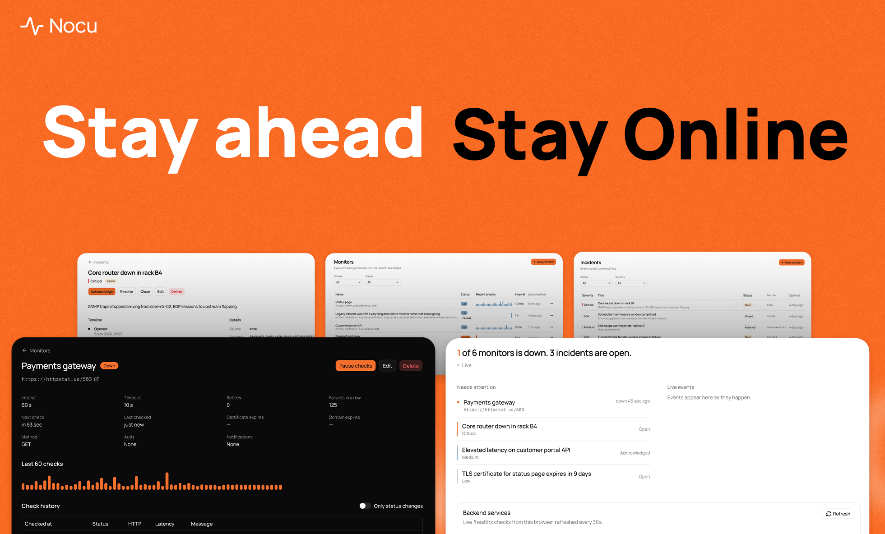

# Nocu

Monorepo for a NOC platform: an incident and uptime-monitor API with realtime WebSocket push, an identity service, an event consumer and a cron scheduler that probes monitors, plus a Next.js web app. Go services use PostgreSQL via GORM and NATS JetStream for messaging.



## Layout

```
build/              one Dockerfile per image (Dockerfile.core-api, .identity, .consumer, .scheduler, .migrate, .web)
cmd/migrate/        migration CLI (up | down | status)
services/<name>/
  cmd/main.go       service entrypoint
  internal/         service-private packages
                    core-api/internal/monitor: monitor CRUD and heartbeat history
                    scheduler/internal/uptime: HTTP probes, expiry checks, notification delivery
shared/
  auth/             JWT issue and verify
  config/           env-based config blocks (Base, HTTP, JWT)
  database/         GORM + PostgreSQL connection, slog bridge
  httpx/            Echo server factory, middleware, error envelope
  logger/           slog setup
  messaging/        Publisher/Subscriber contract, NATS JetStream and in-memory impls
  migration/        versioned gormigrate migrations
  model/            GORM models (User, Role, Incident, Event, ScheduledJob, Monitor, MonitorNotification, MonitorHeartbeat)
web/                Next.js app (App Router, Tailwind v4, shadcn/ui on Radix); pnpm workspace member
  src/app/          routes (/, /login); /api/auth/* route handlers proxy identity and keep the refresh token in an httpOnly cookie
  src/components/   app shell, theme toggle, login form, shadcn components under ui/
  src/lib/api/      typed fetch client for the {data, meta} / {error} envelopes, TanStack Query options (health.ts)
  src/lib/auth/     zod schemas, in-memory access-token store, server-side session helpers
```

## Services

| Service   | Port | Role |
|-----------|------|------|
| identity  | 8081 | register, login, refresh, `/me`; issues JWTs |
| core-api  | 8080 | incident CRUD, monitor CRUD and heartbeat history; `GET /api/v1/ws` pushes every `incident.*`, `job.*` and `monitor.*` event to clients |
| consumer  |      | durable JetStream consumer; persists every message as an `events` row |
| scheduler |      | cron jobs (heartbeat, SLA check, event cleanup, heartbeat cleanup), uptime probes and certificate/domain expiry checks, with Postgres advisory locks |
| web       | 3000 | Next.js UI; talks to identity and core-api from the browser, so their `CORS_ORIGINS` must include the web origin outside development |

## Quick start

```bash
cp .env.example .env
docker compose up --build -d        # postgres, nats, migrate, the four Go services and web on :3000
```

Register, log in, create an incident, and watch it arrive over WebSocket:

```bash
curl -s localhost:8081/api/v1/auth/register -H 'content-type: application/json' \
  -d '{"email":"ops@example.com","password":"correct horse","name":"Ops"}'

TOKEN=$(curl -s localhost:8081/api/v1/auth/login -H 'content-type: application/json' \
  -d '{"email":"ops@example.com","password":"correct horse"}' | jq -r .data.access_token)

# in another terminal (needs websocat):
websocat "ws://localhost:8080/api/v1/ws?token=$TOKEN"

curl -s localhost:8080/api/v1/incidents -H "authorization: Bearer $TOKEN" \
  -H 'content-type: application/json' \
  -d '{"title":"Core router down","severity":"critical","source":"snmp"}'
```

New users get the `viewer` role, which can read incidents and monitors and connect to the WebSocket. Creating or updating incidents and monitors requires `operator` or `admin`; grant it directly in the `user_roles` table for now, then log in again.

## Uptime monitors

A monitor probes one `http://` or `https://` URL on a fixed interval. The scheduler picks up monitors that are due, runs the request with the configured method, body, headers, authentication, redirect limit and timeout, stores a heartbeat per probe, and publishes `monitor.up` / `monitor.down` when the status changes. Optional daily checks publish `monitor.cert_expiring` and `monitor.domain_expiring`.

```bash
curl -s localhost:8080/api/v1/monitors -H "authorization: Bearer $TOKEN" \
  -H 'content-type: application/json' \
  -d '{
    "name": "Public website",
    "url": "https://example.com/health",
    "interval_seconds": 60,
    "retries": 1,
    "timeout_seconds": 30,
    "cert_expiry_notification": true,
    "notifications": [
      { "type": "discord", "enabled": true,
        "config": { "webhook_url": "https://discord.com/api/webhooks/123/abc", "message_format": "embed" } }
    ]
  }'
```

Within the first interval the WebSocket client from the previous section receives a `monitor.up` (or `monitor.down`) frame; later frames arrive only when the status flips. `GET /api/v1/monitors/{id}/heartbeats` returns the probe history. `POST .../pause` and `.../resume` stop and restart probing.

With `"auto_create_incident": true` the scheduler also opens a `critical` incident (source `monitor`, linked by `monitor_id`) the moment the monitor flips to `down`, and publishes `incident.created`. A monitor never has more than one open or acknowledged incident at a time; recovery does not close it, an operator does. `GET /api/v1/incidents?monitor_id={id}` lists a monitor's incidents.

Notification channels are attached per monitor:

| Type      | Delivered | Notes |
|-----------|-----------|-------|
| `discord` | yes       | webhook URL, bot display name, prefix message, `text` or `embed` format, optional URL hiding |
| `webhook` | yes       | post URL, method, `json` / `form` / `custom` body with placeholders, extra headers |
| `webpush` | not yet   | the browser `PushSubscription` is stored and validated; delivery needs VAPID keys and is a follow-up |

Secrets (`basic_password`, `bearer_token`) are write-only and never returned by the API. Probes refuse loopback and private IP targets unless `SCHEDULER_MONITOR_ALLOW_PRIVATE=true`. See `bruno/core-api/monitors` for the full field list.

## Local development

```bash
docker compose up -d postgres nats   # just the dependencies
make migrate                         # apply migrations
make dev                             # all four services with hot reload (Air)
make test                            # unit tests (Go + web)
make lint                            # gofmt + go vet + web lint/typecheck
```

### Frontend

The web app lives in `web/` and is a [pnpm](https://pnpm.io) workspace member (`pnpm-workspace.yaml` at the root). It needs Node 24 (see `web/.nvmrc`).

```bash
make web-install                     # pnpm install --frozen-lockfile
make dev-web                         # next dev on http://localhost:3000
make web-lint && make web-test       # eslint + tsc, vitest
make web-build                       # next build (standalone output)
```

With no `.env.local` the app targets `localhost:8081` (identity) and `localhost:8080` (core-api), which matches `docker compose up -d postgres nats` plus `make dev`. Copy `web/.env.example` to `web/.env.local` to point elsewhere. `NEXT_PUBLIC_*` values are baked into the browser bundle at build time, so `build/Dockerfile.web` takes them as build args and the compose file passes them through from `.env`.

Add shadcn components with `cd web && pnpm dlx shadcn@latest add <name>`; they land in `web/src/components/ui/`.

Data fetching uses [TanStack Query](https://tanstack.com/query): `QueryProvider` in the root layout owns one `QueryClient` per browser tab (defaults in `web/src/lib/query-client.ts`, which never retries 4xx responses), and devtools are available in development. Define queries with `queryOptions` next to the API code, as `web/src/lib/api/health.ts` does. Forms use [react-hook-form](https://react-hook-form.com) with [zod](https://zod.dev) schemas via `zodResolver`, rendered with shadcn's `Field` components (shadcn v4 replaced the old `Form` wrapper with `Field` plus `Controller`); `web/src/components/login-form.tsx` is the reference, including mapping backend `ApiError`s onto form errors. The access token returned by `/api/auth/login` is kept in memory in `web/src/lib/auth/session-store.ts`; a page reload gets a new one from `POST /api/auth/refresh`.

### Hot reload

`make dev-<service>` runs one service under [Air](https://github.com/air-verse/air) and rebuilds it whenever a `.go` file under `services/<service>/` or `shared/` changes. `make dev` runs all four in one terminal; Ctrl+C stops everything. Install Air once with:

```bash
go install github.com/air-verse/air@latest
```

Configs live in `.air/<service>.toml`. Identity is pinned to port 8081 there so it never collides with core-api. Build output goes to `tmp/`, which is gitignored.

Without Air, `HTTP_PORT=8081 make run-identity` and `make run-<service>` still work but need a manual restart after each change.

## Migrations

Migrations live in `shared/migration` and run with gormigrate inside a transaction.

- `make migrate` / `make migrate-down` / `make migrate-status`
- Add a new file `shared/migration/<timestamp>_<name>.go` and append it to `list` in `migration.go`.
- Only the init migration references `shared/model` directly. Later migrations declare local struct copies so editing a model never rewrites history.

## Docker images

```bash
make docker-build                 # all six images
make docker-build-core-api        # one image
```

Each Go Dockerfile is a two-stage build: `golang:1.26-alpine` compiles a static binary, and `gcr.io/distroless/static-debian12:nonroot` runs it. `Dockerfile.web` installs the pnpm workspace, runs `next build` with `output: "standalone"`, and serves it from `node:24-alpine` as the `node` user. The build context must be the repository root.

## API documentation (Bruno)

The `bruno/` folder is a [Bruno](https://www.usebruno.com) collection that documents every endpoint. Open Bruno, choose **Open Collection**, pick `bruno/`, and select the `local` environment.

Run `identity / Register` then `identity / Login`; the login script stores the tokens in the environment and every other request inherits the bearer token. `core-api / incidents / Create` stores the new id in `incidentId` for the get, update, and delete requests. The `WebSocket (reference)` request documents the stream; connect with `websocat` or a browser client as described in its docs tab.
