# Screenshots

Dark and light theme captures of the web app. Source files live in [`docs/screenshots/`](screenshots).

[← Back to README](../README.md)

| Page | Dark | Light |
|------|------|-------|
| Login | 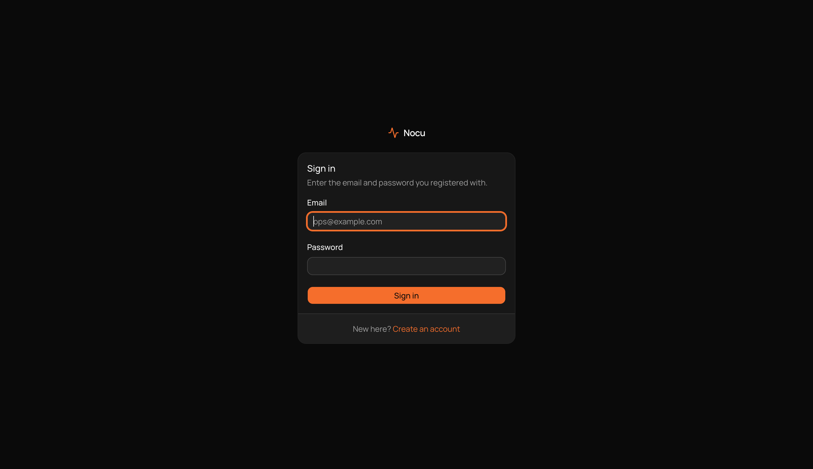 | 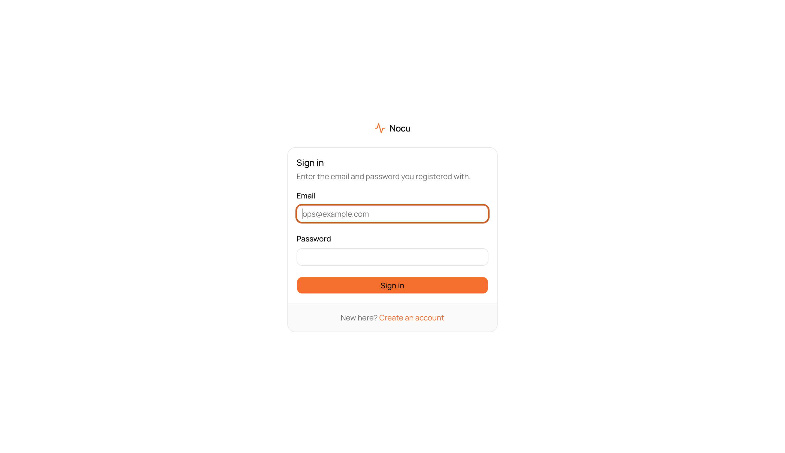 |
| Overview | 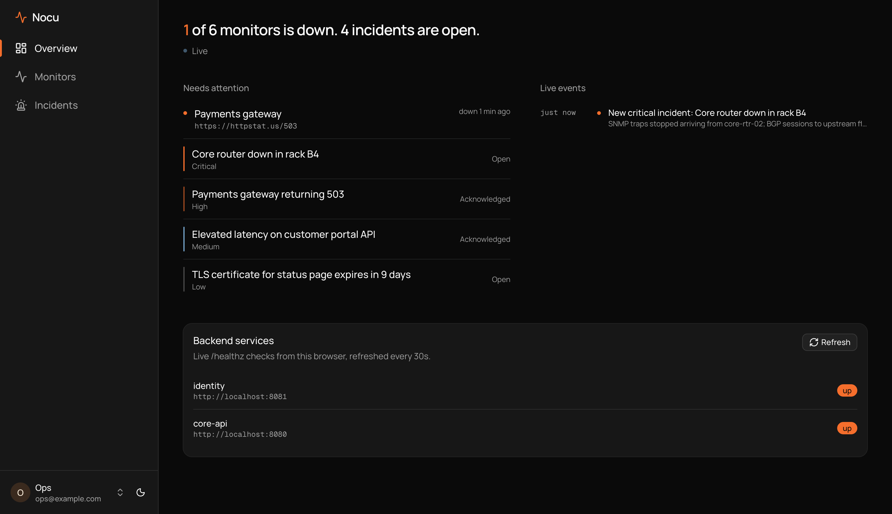 | 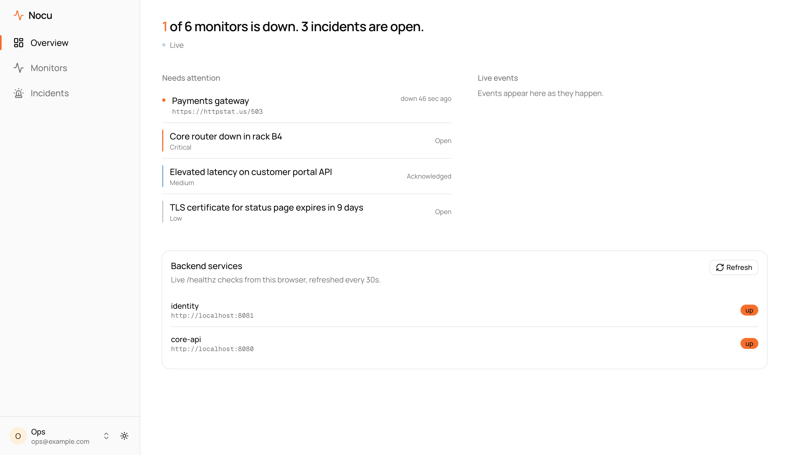 |
| Incidents | 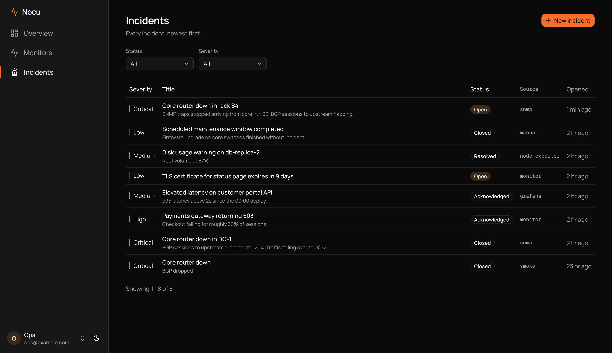 | 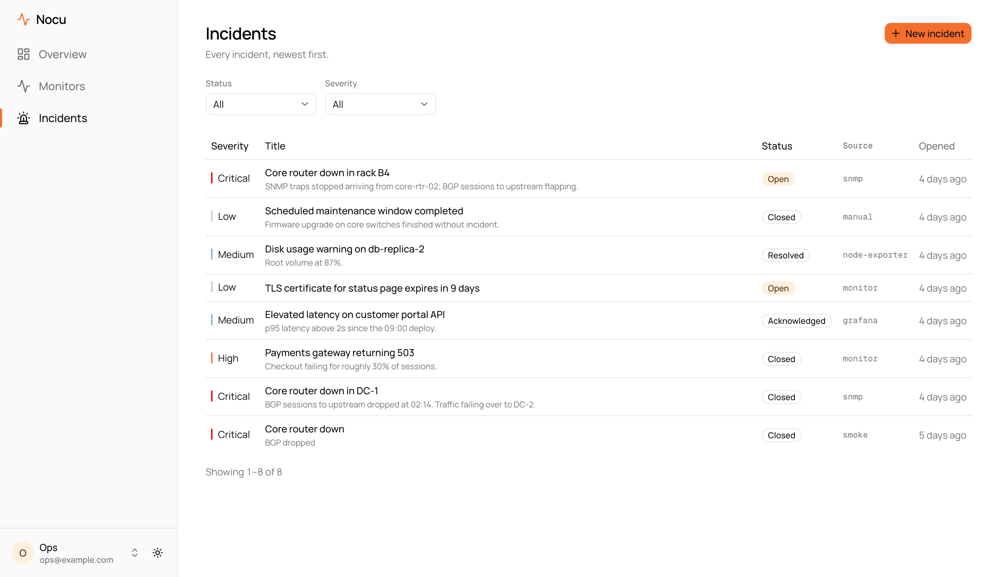 |
| Incident detail | 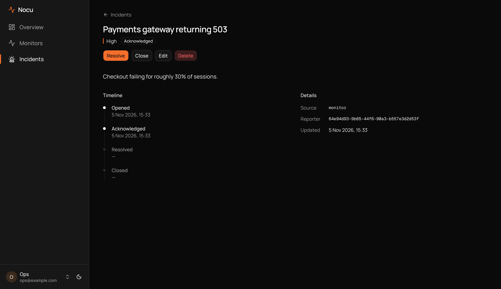 | 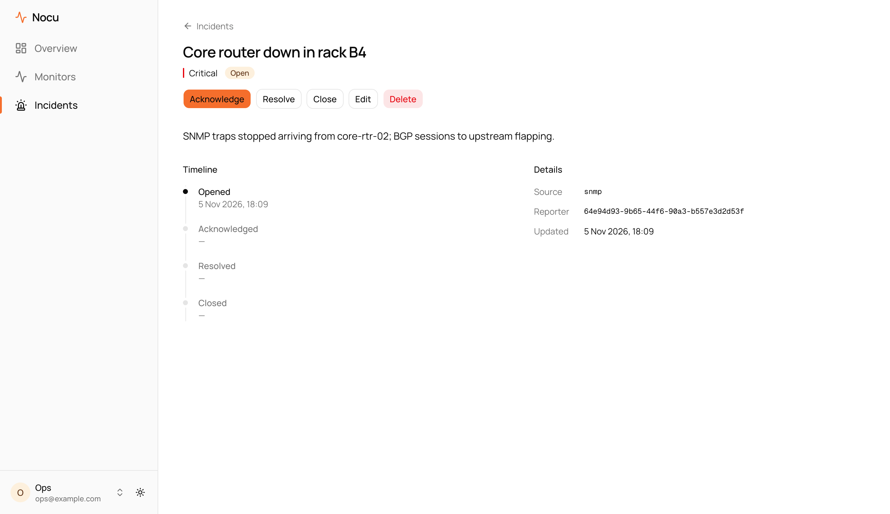 |
| Monitors | 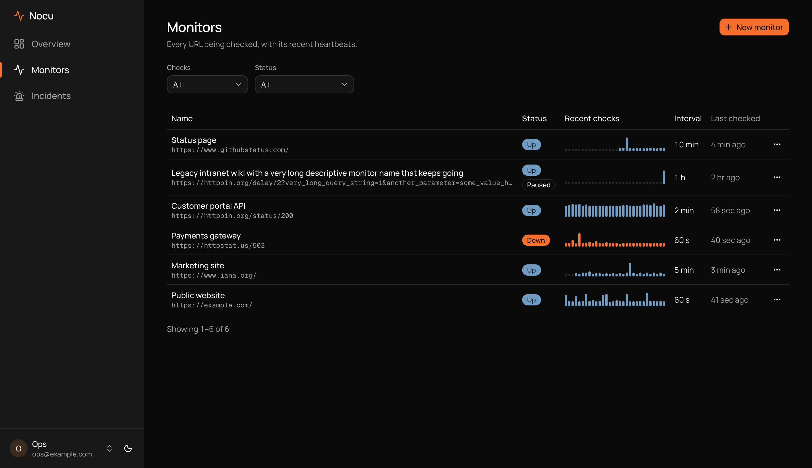 | 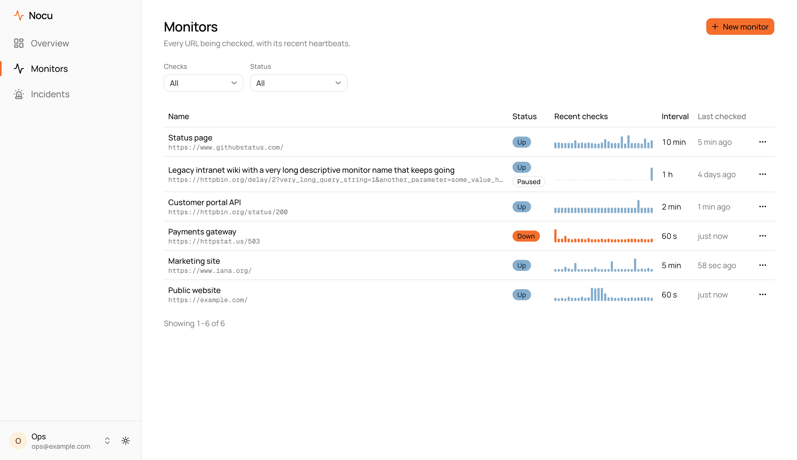 |
| Monitor detail | 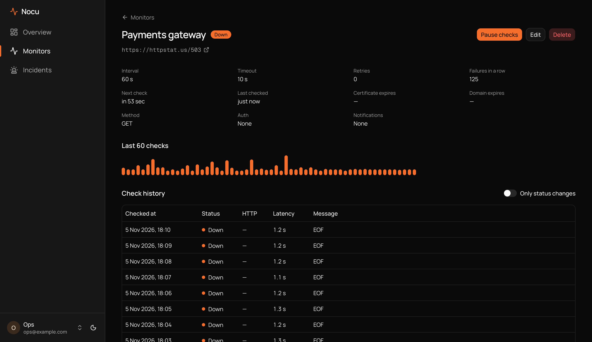 | 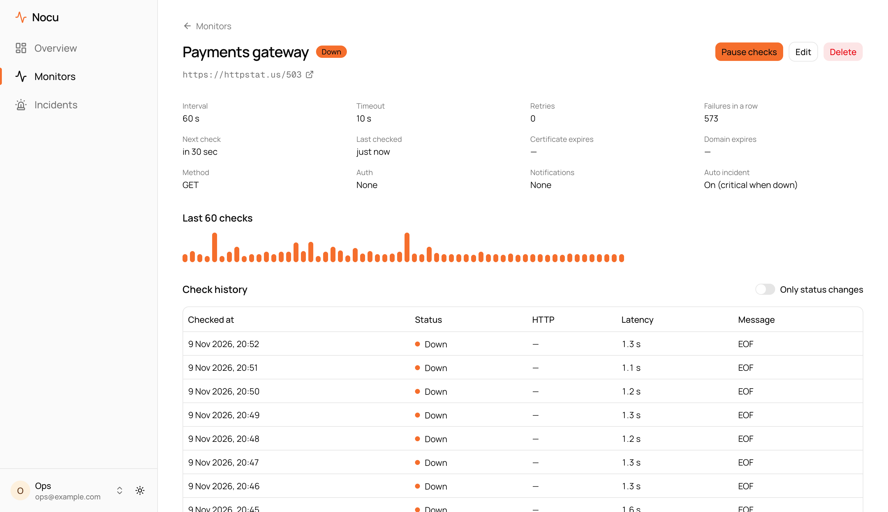 |
| New monitor | 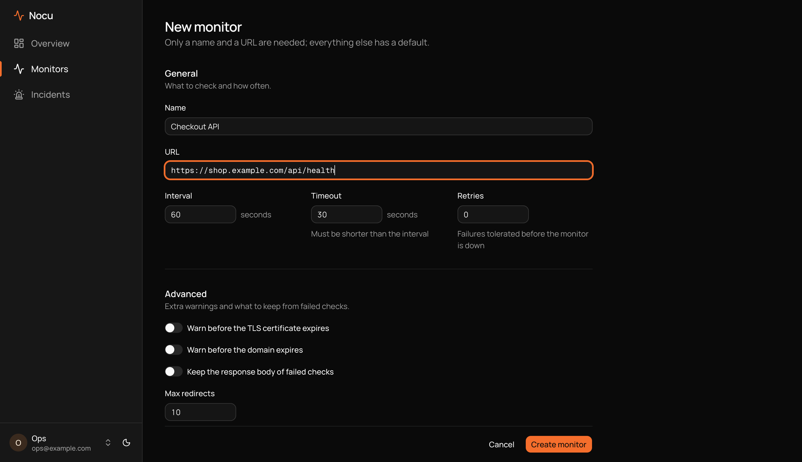 | 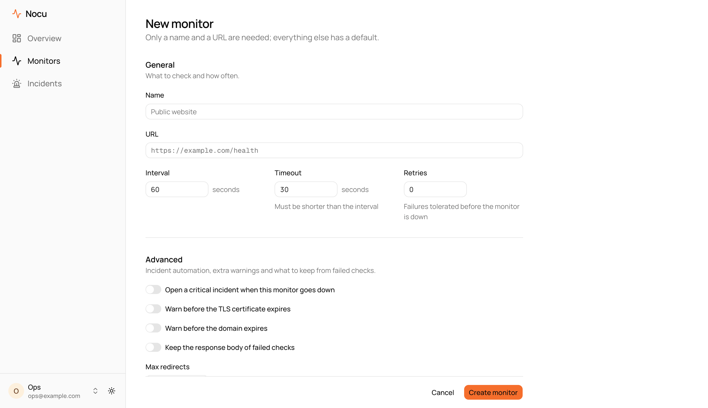 |
